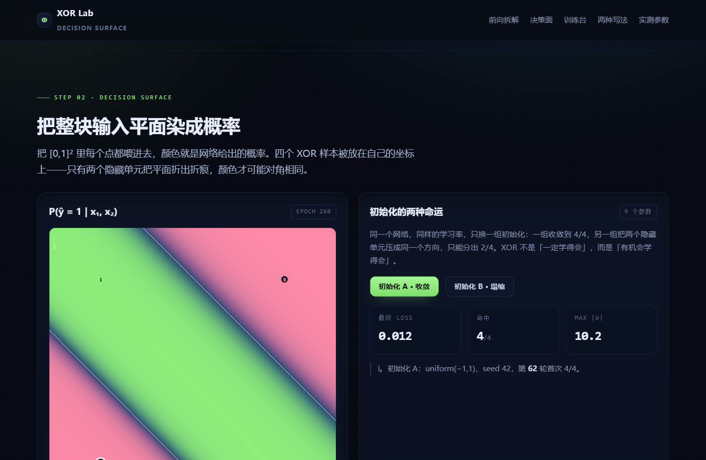

# XOR · 决策面实验室

一个单文件、零依赖的交互式教学页：把 2 → 2 → 1 的多层感知机在 XOR 上的学习过程摊开来看。




- **前向拆解**：点四个样本中的任意一个，看 z → h → logit → ŷ 每一步的具体数值；连线粗细 = 权重绝对值，绿色为正、粉色为负。
- **决策面**：把 [0,1]² 整块平面染成概率色，白线是 0.5 等值线，四个样本点叠在真实坐标上。
- **训练台**：拖动轮次滑块（0–260），损失曲线、决策面、网络权重、样本预测同步重算；可从头播放。
- **两种初始化**：同一套超参数，初始化 A 收敛到 4/4，初始化 B 塌缩成单独一条分界线，只命中 2/4。
- **两种写法**：PyTorch 命令式循环 vs JAX 函数式（`jax.value_and_grad` + optax）的等价实现。
- **实测参数**：本地 float64 与 float32 两次运行的全部 9 个参数对照，最大差 2.1e−06。

## 数学设定

| 项目 | 取值 |
| --- | --- |
| 结构 | 2 → 2 → 1，隐藏层 sigmoid，输出层取 logit |
| 损失 | 全批量 `BCEWithLogits` 均值 |
| 优化器 | Adam(β₁=0.9, β₂=0.999, ε=1e−8)，lr = 0.06 |
| 轮次 | 260 |
| 初始化 | uniform(−1, 1)，b = 0，c = 0 |
| 参数量 | 9 |

前向：

```
h     = σ(x·W + b)
logit = h·v + c
ŷ     = σ(logit)
```

页面上所有数字都由浏览器里的 JavaScript 现场算出（手写反向传播 + Adam），不访问任何后端。

## 文件

```
index.html               # 全部内容：样式、交互、训练循环
tools/reference_run.py   # 本地 NumPy 复现脚本，用于核对页面数值（float64 / float32 两次运行）
```

## 本地查看

直接双击 `index.html`，或在目录里起一个静态服务器：

```bash
python -m http.server 8000
```

## 复现参考数值

```bash
python tools/reference_run.py
```

会打印初始化权重、最终 9 个参数、四个样本的预测概率，以及 float32 与 float64 的最大参数差。
